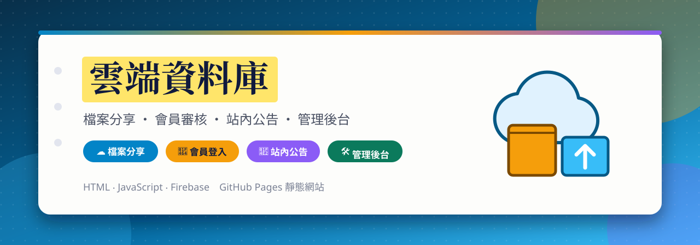
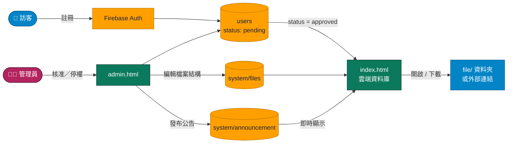

<a id="top"></a>

<div align="center">



<br>

[](https://github.com/Jiachang1112/Jiachang)
[](https://github.com/Jiachang1112)
[](https://jiachang1112.github.io/Jiachang/)

[](https://developer.mozilla.org/docs/Web/HTML)
[](https://developer.mozilla.org/docs/Web/CSS)
[](https://developer.mozilla.org/docs/Web/JavaScript)
[](https://firebase.google.com/)
[](https://firebase.google.com/docs/firestore)
[](https://firebase.google.com/docs/auth)
[](https://fonts.google.com/)
[](https://pages.github.com/)

**檔案與資料夾雲端分享 ‧ 會員註冊與審核 ‧ 收藏與置頂 ‧ 站內公告 ‧ 管理後台**

<br>

[](#-特色)
[](#-快速開始)
[](#-設定你自己的-firebase)
[](#-部署)
[](#-注意事項)
[](#-常見問題)

</div>

---

## ✨ 特色

<table>
<tr>
<td width="33%" valign="top">

### ☁️ 雲端資料庫
把課程講義、簡報、圖片、影片連結整理成資料夾樹狀結構，點一下就能開啟或下載。檔案類型（PDF、簡報、圖片、影片）會自動顯示不同圖示。

</td>
<td width="33%" valign="top">

### 👤 會員與審核
訪客可以用信箱註冊，帳號預設是「審核中」，要由管理員核准後才能進入；也可以隨時停權。

</td>
<td width="33%" valign="top">

### ⭐ 收藏與📌置頂
每位會員都可以替檔案加星號收藏、置頂常用項目，只看收藏的內容，設定會跟著帳號走。

</td>
</tr>
<tr>
<td width="33%" valign="top">

### 📢 站內公告
管理員在後台發布公告，所有會員的頁面會即時看到，不必重新整理。

</td>
<td width="33%" valign="top">

### 🛠️ 管理後台
`admin.html` 提供「檔案管理」「會員審核」「發布通知」三個分頁，可以直接編輯檔案與資料夾結構。

</td>
<td width="33%" valign="top">

### 🌗 深淺色
介面支援深色／淺色模式，偏好會記在瀏覽器裡。

</td>
</tr>
</table>

### 🔗 頁面一覽

| 頁面 | 檔案 | 內容 |
| --- | --- | --- |
| ☁️ 雲端資料庫 | `index.html` | 會員登入後瀏覽檔案（`text.html` 是同一份的副本） |
| 🛠️ 管理後台 | `admin.html` | 管理員專用：檔案、會員、公告 |
| 🧭 入口頁範例 | `Jiachang.html` | 簡單的「我的網站入口」連結頁範本 |
| 📍 座標轉換器 | `another.html` | 把「北43.26132° 東141.96267°」轉成可複製的十進位座標 |
| ⚙️ 範例設定 | `config.js` | 檔案清單的範例格式（資料夾版） |

---

## 🧩 運作方式



- 網站是**純靜態檔案**，Firebase 從 CDN 載入，**不需要 `npm install` 也不需要 build**。
- 檔案清單存在 Firestore 的 `system/files`，管理員在後台改完會立刻更新；`config.js` 是範例格式與備用資料。
- 會員資料在 `users/{uid}`，`status` 是 `pending`（審核中）、`approved`（已核准）或 `suspended`（停權）。
- 公告存在 `system/announcement`，頁面用即時監聽顯示。

### 📁 檔案說明

```text
Jiachang/
├── index.html      雲端資料庫（會員版）
├── text.html       index.html 的副本
├── admin.html      管理後台
├── Jiachang.html   入口頁範例
├── another.html    座標轉換器
├── config.js       檔案清單範例
└── file/           放簡報、文件等檔案
```

---

## ⚡ 快速開始

```bash
git clone https://github.com/Jiachang1112/Jiachang.git
cd Jiachang
python3 -m http.server 8000
```

| 想看什麼 | 網址 |
| --- | --- |
| ☁️ 雲端資料庫 | http://localhost:8000/ |
| 🛠️ 管理後台 | http://localhost:8000/admin.html |
| 📍 座標轉換器 | http://localhost:8000/another.html |

登入需要連到 Firebase，請繼續看下一節。

---

## 🔥 設定你自己的 Firebase

專案預設連到作者自己的 Firebase，如果你是複製來用，**請換成你自己的專案**。

1. 到 [Firebase 主控台](https://console.firebase.google.com/) 建立專案，開啟 **Authentication**（信箱／密碼）與 **Firestore Database**。
2. 專案設定 → 新增網頁應用程式，把 `index.html` 與 `admin.html` 裡的 `firebaseConfig` 換成你的。
3. Authentication → Settings → **已授權網域**，加入你的網域。
4. 到 Firestore 的「規則」頁設定安全規則：
   - 會員只能讀寫自己的 `users/{uid}`，且**不能自己改 `status`**。
   - `system/files`、`system/announcement` 只有管理員能寫入。
5. 用管理員信箱註冊一次，再到 Firestore 把自己的 `status` 改成 `approved`，之後就能用 `admin.html` 審核其他會員。

> 💡 網頁用的 `apiKey` 不是機密，真正保護資料的是 Firestore 的安全規則。

---

## 🚀 部署

純靜態網站，放在任何靜態空間都可以。這個倉庫目前使用 **GitHub Pages**：Settings → Pages → Source 選 `main` 分支、根目錄。部署後記得把網址加到 Firebase 的**已授權網域**。

---

## ⚠️ 注意事項

- **權限靠 Firestore 規則**：前端的「審核中／已核准」只是畫面判斷，規則沒擋住 `status` 欄位，會員就可能自己改成已核准。
- **不要把帳號密碼寫在前端程式碼裡**：網頁上的所有內容任何人都看得到。要讓訪客臨時瀏覽，請改用 Firebase 的匿名登入搭配規則，或只在規則允許的範圍開放唯讀。
- **檔案是公開的**：放在 `file/` 資料夾的檔案，知道網址的人都能下載；不要放個資或機密文件。
- 單一檔案過大（例如十幾 MB 的簡報）會讓倉庫變肥，大檔案建議改放雲端空間，再用連結引用。

---

## ❓ 常見問題

<details>
<summary><b>註冊後一直顯示「帳號尚在審核中」</b></summary>

正常現象，需要管理員到 `admin.html` →「會員審核」把你的帳號改成已核准。

</details>

<details>
<summary><b>進不了管理後台</b></summary>

後台使用 Firebase 的信箱／密碼登入，請確認帳號存在且有管理權限（依照你設定的 Firestore 規則）。

</details>

<details>
<summary><b>新增了檔案但頁面沒出現</b></summary>

管理員在後台改完要按儲存；另外也要確認檔案真的放進 `file/` 資料夾並已推到 GitHub。

</details>

<details>
<summary><b>Google／信箱登入說網域未授權</b></summary>

Firebase → Authentication → Settings → 已授權網域，加入你的網域。

</details>

---

<div align="center">

[GitHub @Jiachang1112](https://github.com/Jiachang1112)　‧　[Jiachang](https://github.com/Jiachang1112/Jiachang)

[](#top)

</div>
